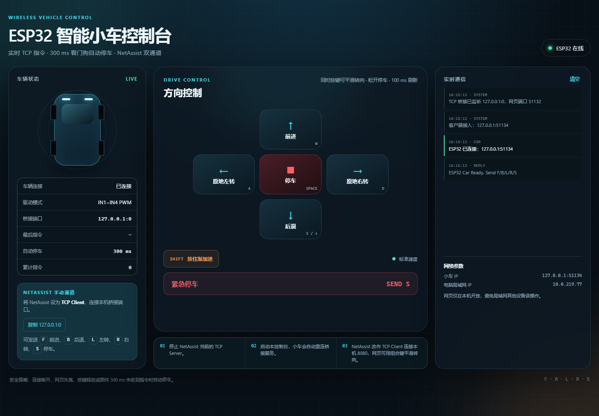
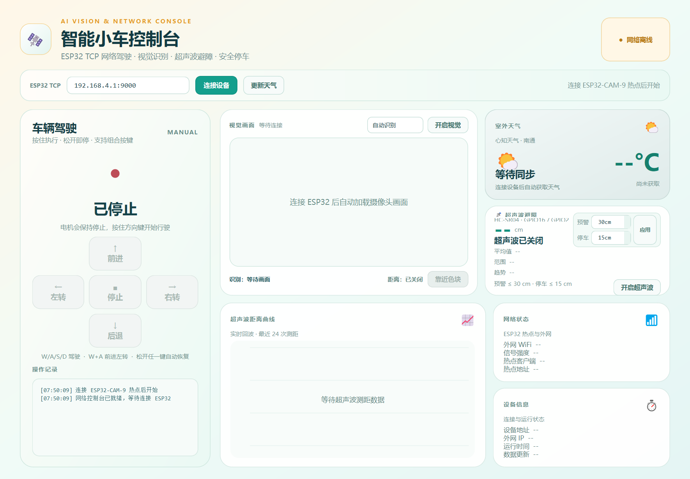
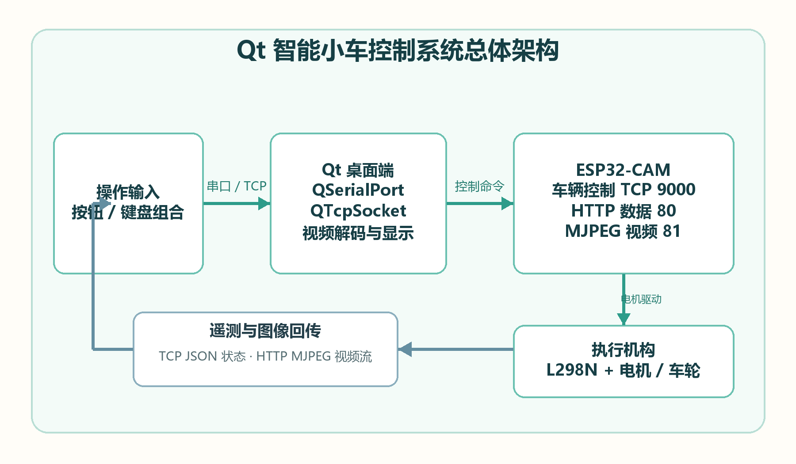
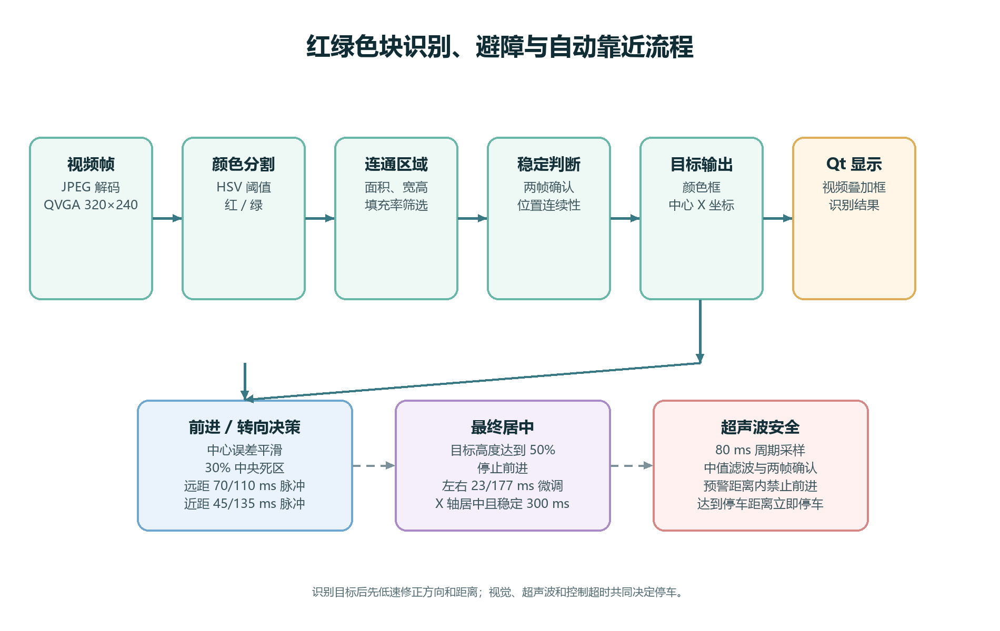

# ESP32 智能小车多模式控制系统

一个面向嵌入式与物联网实践的综合项目，覆盖四路红外循迹、超声波避障、ESP32-CAM 图传、OpenCV 色块识别、Qt 6 上位机、Web 控制台和本地 TCP 桥接服务。

项目重点不是单一模块演示，而是把**感知、决策、执行、远程控制与可视化**串成一套完整链路：

```text
红外 / 超声波 / 摄像头
          ↓
ESP32 感知与运动控制
          ↓
TCP 协议 → 本地桥接 → Web 控制台
          ↓
ESP32-CAM 图传 → Qt 上位机 → OpenCV 识别 → 自动靠近
```

## 实现效果

| Web 控制台 | Qt 视觉与控制台 |
| --- | --- |
|  |  |





## 核心功能

- **四路红外循迹**：采集赛道偏差，结合差速转向完成直线、弯道和路口行驶。
- **超声波避障**：HC-SR04 实时测距，按距离分级减速，进入危险距离后执行绕行。
- **差速驱动**：L298N 控制左右轮，PWM 调速，支持前进、后退、左转、右转和组合转向。
- **ESP32-CAM 图传**：摄像头画面通过 Wi-Fi 传输到 Qt 上位机。
- **视觉目标识别**：OpenCV 对红 / 绿目标进行阈值分割、轮廓筛选和位置判断。
- **自动靠近**：根据目标在画面中的位置和面积，动态调整左右轮速度和接近策略。
- **Web 控制台**：按住方向键控制小车，组合键自动生成差速转向命令。
- **本地 TCP 桥接**：浏览器使用 HTTP，ESP32 使用原始 TCP，由 Node.js 服务完成协议转换。
- **安全保护**：300 ms 指令超时停车、页面失焦停车、连接断开保护和平滑 PWM 渐变。

## 关键实现

### 1. 循迹与避障状态机

- 四路红外传感器输出离散赛道状态，代码根据传感器组合判断偏左、偏右、直行、丢线和路口。
- 超声波距离划分为正常、减速、绕行三个区间，避免固定速度导致反应距离不足。
- 绕行采用“偏转 - 斜向通过 - 反向回正”的有限状态流程，左右绕行方向交替，降低连续障碍场景中的累计偏差。
- 电机速度使用渐变方式调整，避免突然满占空比造成打滑和电流冲击。

### 2. 视觉识别与自动靠近

- Qt 上位机接收 ESP32-CAM 视频流并显示实时画面。
- OpenCV 将画面转换到 HSV 空间，分别提取红色和绿色区域。
- 通过面积阈值过滤噪声，再根据轮廓中心与画面中心的偏差判断目标方向。
- 当目标面积小于阈值时执行靠近，接近目标后降低速度并最终停车。
- 识别结果和控制状态同步显示在 Qt 控制台中，便于调试和演示。

### 3. Web 控制与 TCP 桥接

- Web 控制台提供前进、后退、左转、右转、停车五个主按钮。
- 同时按住两个方向键时，前端自动组合为 `FL`、`FR`、`BL`、`BR` 等差速指令。
- 按住 `Shift` 或页面上的加速按钮时，发送小写命令进入加速模式。
- 浏览器不能直接建立原始 TCP 连接，因此由本地 Node.js 服务在 HTTP 与 ESP32 TCP 之间转发。
- 小车超过 300 ms 未收到新指令时自动停车；页面失焦、按键释放或桥接服务断开时也会发送停车指令。

## 测试与验证

Web 控制端已通过自动化测试：

```bash
cd web-controller
npm test
```

验证内容：

- 5 个测试全部通过
- 1440×1000、1024×900、736×900、390×844 四种视口无横向溢出
- 方向键按住时持续刷新指令
- `W + A` 组合键持续生成差速转向命令
- `Shift` 与屏幕加速按钮均能切换加速模式
- 无效指令和断开连接时安全拒绝或停车
- 固件支持的全部组合方向命令均可被桥接服务识别

## 目录结构

```text
esp32-smart-car/
├── firmware/
│   ├── esp32-cam/        ESP32-CAM 图传、色块识别与避障固件
│   └── arduino/          Arduino 循迹与超声波避障示例
├── desktop/Car/          Qt 6 桌面控制台源码
├── web-controller/       Node.js TCP 桥接与网页控制台
└── docs/images/          运行效果与架构图
```

## 快速开始

### 1. 配置固件

使用 Arduino IDE 打开 `firmware/esp32-cam/Esp32CarVisionObstacle.ino`，先修改：

```cpp
const char *STA_SSID = "YOUR_WIFI_SSID";
const char *STA_PASSWORD = "YOUR_WIFI_PASSWORD";
const char *AP_PASSWORD = "YOUR_AP_PASSWORD";
```

然后选择 ESP32-CAM 开发板和串口，编译并烧录。详细说明见 `firmware/esp32-cam/README.txt`。

### 2. 启动 Web 控制台

```bash
cd web-controller
npm install
npm test
npm start
```

浏览器打开控制台。ESP32 默认作为 TCP Client 连接电脑的 `8080` 端口；如果需要更改设备 IP 或端口，请同步修改固件和桥接配置。

### 3. 编译 Qt 上位机

使用 Qt 6 打开 `desktop/Car/Car.pro`，选择对应 Kit 后构建运行。编译说明见 `desktop/Car/README_编译说明.txt`。

## 技术栈

ESP32 · Arduino · L298N · HC-SR04 · 四路红外传感器 · ESP32-CAM · OpenCV · C++ · Qt 6 · Node.js · TCP / HTTP · PWM

## 已知限制与改进方向

- 循迹参数依赖场地、轮胎和供电状态，换场地后需要重新标定。
- 色块识别对光照变化敏感，后续可替换为颜色空间自适应或轻量目标检测模型。
- 当前 Web 控制端默认只允许本机访问，适合课程演示和局域网调试。
- 后续可增加里程计、IMU 姿态融合和路径规划，提高复杂赛道下的稳定性。
